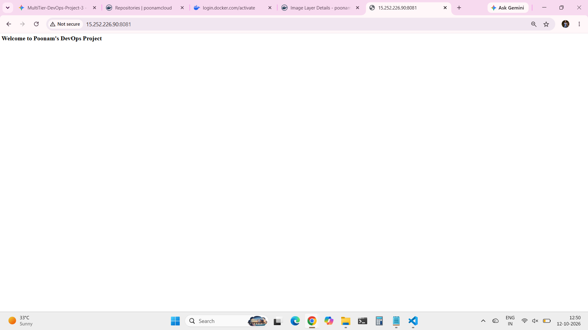
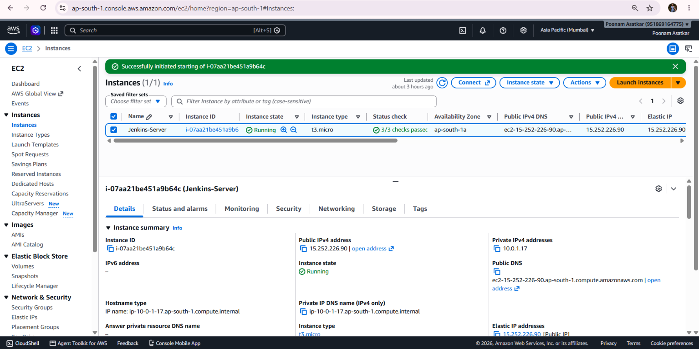
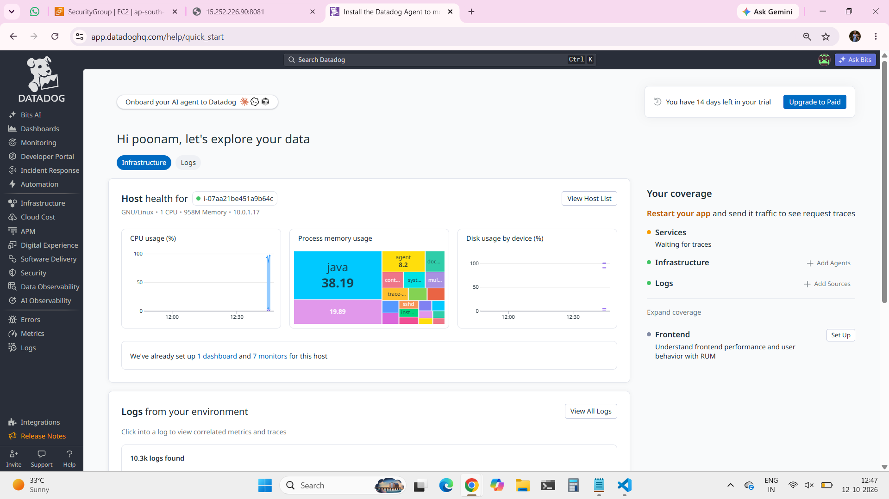
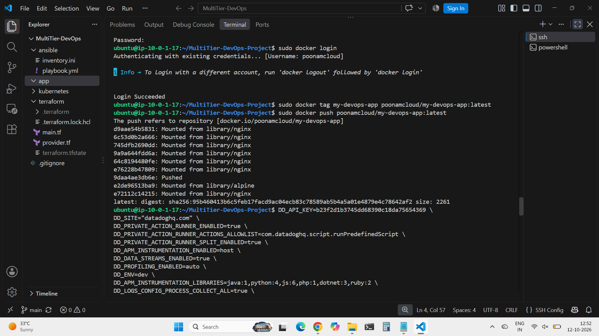
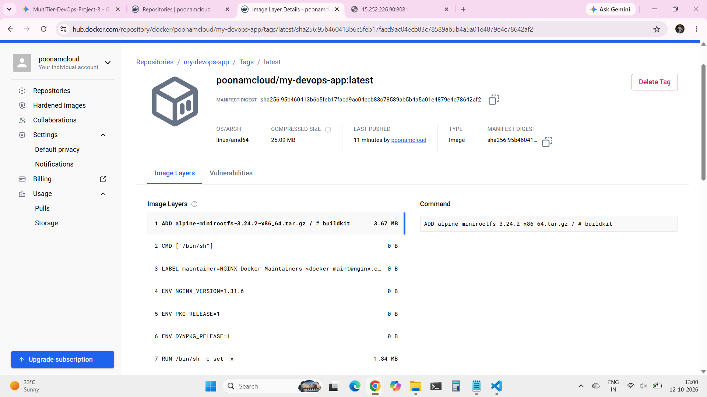

# End-to-End DevOps Deployment & Monitoring Project

## 📌 Project Overview
This project demonstrates a complete DevOps lifecycle, including the containerization of a web application, deployment on cloud infrastructure, image registry management, and enterprise-level system monitoring. 

## 🛠️ Tech Stack
* **Cloud Provider:** AWS (EC2 Ubuntu Instance)
* **Containerization:** Docker
* **Image Registry:** Docker Hub
* **Monitoring & Observability:** Datadog
* **Web Server:** Nginx / Custom Application

## 🚀 Key Implementations
1. **Application Containerization:** Built a custom Docker image for the web application and successfully mapped it to host ports.
2. **Cloud Deployment:** Provisioned an AWS EC2 instance (Ubuntu) and deployed the containerized application, making it publicly accessible.
3. **Registry Management:** Tagged and pushed the final Docker image (`poonamcloud/my-devops-app:latest`) to Docker Hub for version control and easy distribution.
4. **Infrastructure Monitoring:** Integrated the Datadog Agent on the AWS EC2 instance to monitor host health, CPU/Memory usage, and Docker container metrics in real-time.

## 📸 Project Evidence & Screenshots

**1. Live Application Output**

**2. AWS EC2 Instance Running**

**3. Datadog Live Monitoring Dashboard**

**4. Docker Build & Push Logs**

**5. Docker Hub Repository**

## 💡 Challenges Solved
* **Port Conflict Resolution:** Encountered a port binding issue on port `8080`. Successfully troubleshooted and re-mapped the application to port `8081` without application downtime.
* **Permission Management:** Handled Docker daemon permission issues on the Linux host by configuring user groups properly.
